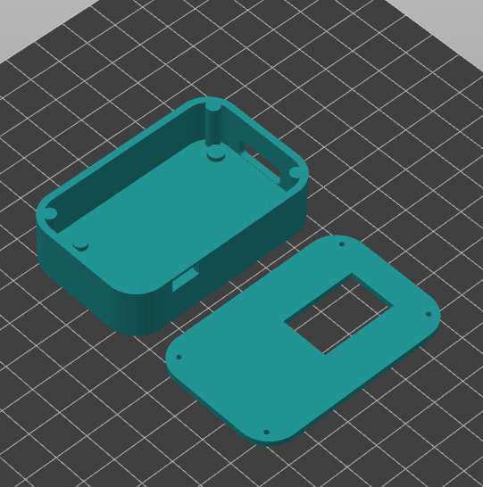

# TheBox — Message Box

TheBox es una cajita de mensajes basada en un **ESP32**, una pantalla OLED monocromática de **0,96 pulgadas (128 × 64)** y un sensor táctil **TTP223**. Al encenderse, reproduce una breve animación de introducción y luego muestra mensajes personales. Los mensajes se pueden recorrer con el touch o administrar desde una página web alojada por el propio ESP32.

## Qué hace

- Reproduce una animación introductoria almacenada como fotogramas monocromáticos en `include/VideoFrame.h`.
- Muestra los saludos iniciales «para la más linda» y «Hola "-custom name-" <3».
- Permite entrar al modo de configuración al tocar tres veces durante el segundo que aparece el saludo. En pantalla se indica el nombre de la red Wi-Fi y la dirección IP; los tres círculos muestran el progreso de los toques.
- Crea una red Wi-Fi llamada `CajitaMSG`. Al conectarse a ella, se puede abrir `http://192.168.4.1` para ver, agregar y eliminar mensajes.
- Guarda los mensajes en la memoria no volátil del ESP32, por lo que se conservan al reiniciar.
- Avanza entre los mensajes con cada toque. El texto se ajusta a la OLED: se centra, ocupa varias líneas cuando hace falta y reduce el tamaño de fuente si el mensaje es largo.

Para salir del modo de configuración, reinicia la cajita.

## Hardware y pines

| Componente | Conexión configurada |
| --- | --- |
| OLED SDA | GPIO 21 |
| OLED SCL | GPIO 22 |
| OLED I²C | Dirección `0x3C` |
| TTP223 OUT | GPIO 13 |
| Interruptor | Interruptor pequeño de 3 pines para encender y apagar la caja |

El código está preparado para una placa PlatformIO `esp32doit-devkit-v1`. Si tu cableado o la dirección I²C de la pantalla difieren, actualiza las constantes al comienzo de `src/main.cpp`.

## Modelo 3D

El modelo 3D de la carcasa se diseñó en **Fusion 360** y está disponible en [`models/case.3mf`](models/case.3mf).

## Animación de Madoka

Los fotogramas de Madoka incluidos en `include/VideoFrame.h` se generaron a partir de un video con [ESP32 OLED Video Converter](https://triwahyu45.github.io/ESP32-OLED-Video-Converter/). El archivo contiene 42 imágenes monocromáticas de 128 × 64 píxeles, almacenadas en `PROGMEM` para reproducirlas en la OLED.

## Compilar y cargar

1. Abre esta carpeta como proyecto en PlatformIO.
2. Conecta el ESP32 por USB.
3. Compila y carga el firmware en la placa `esp32doit-devkit-v1`.

Las dependencias de Adafruit SSD1306 y ArduinoJson están declaradas en `platformio.ini`; PlatformIO las instala al compilar.
